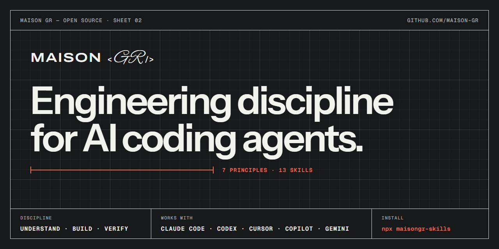
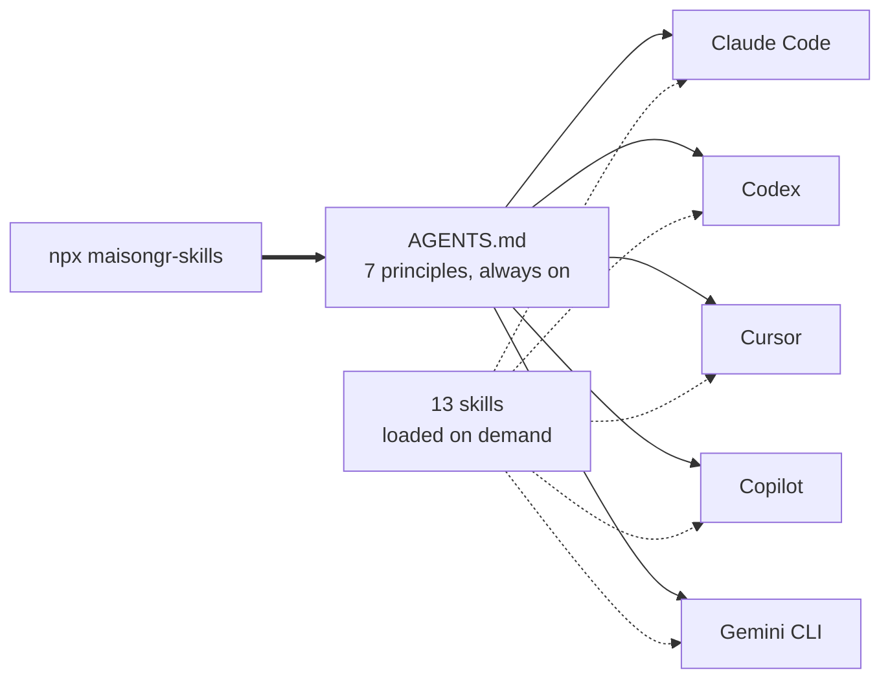
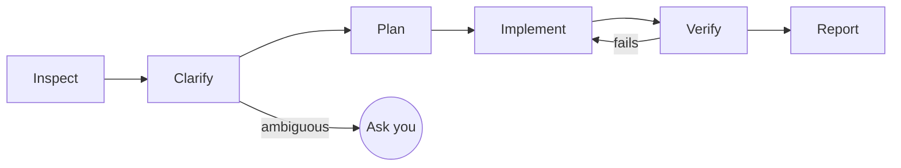

<p align="center">
  
</p>

<h1 align="center">One engineering standard for every AI coding agent</h1>

<p align="center">
  Agents that ask before guessing, change only what you asked,<br>
  and tell you exactly what they did <em>not</em> verify.
</p>

<p align="center">
  Claude Code · OpenAI Codex · Cursor · GitHub Copilot · Gemini CLI
</p>

<p align="center">
  <a href="https://github.com/maison-gr/maisongr-skills/actions/workflows/validate.yml"></a>
  <a href="https://www.npmjs.com/package/maisongr-skills"></a>
  <a href="LICENSE"></a>
</p>

```bash
npx maisongr-skills
```

---

## Why this exists

AI coding agents rarely fail for lack of knowledge. They fail because finishing the task pulls harder than doing it right. So they:

- guess what you meant instead of asking;
- build abstractions and options the task never needed;
- "improve" files nobody mentioned;
- report "all tests pass" without running them;
- leave dev servers running in the background, where you never see them, until the laptop freezes;
- push, drop a column or break a public API when nobody asked them to.

And when your team uses three different agents, you get three different standards, or none.

Maison GR gives every agent the same seven principles and thirteen task methods, from one source file, installed with one command.

## 60 seconds

1. In any project, run `npx maisongr-skills`.
2. Ask your agent for something slightly ambiguous: *"Add caching to the users endpoint."*
3. Instead of guessing, it asks what to cache and for how long, or states the assumptions it made.
4. When it finishes, it reports what it did and what it could not check. For example:

```text
Changed:      src/api/users.ts: added a 60 s cache to GET /users
Verified:     npm test (42 passed), npm run lint (clean)
Not verified: cache invalidation under concurrent writes (no integration environment)
Decisions:    chose in-memory over Redis; revisit if you run more than one instance
```

Undo it any time with `npx maisongr-skills remove`.

## Receipts: "tests pass" you can check

An agent can write "Verified: `npm test` (42 passed)" without having run anything. With the Claude Code plugin installed, Maison GR checks.

- Every shell command the agent runs in a session is recorded, with its exit code.
- When the agent tries to finish, each command listed under **Verified** is checked against that record.
- If a command never ran, or its last run failed while the report says it passed, the agent is sent back to run it and report the real result, or to move it to **Not verified**.
- It also catches **guarded, irreversible actions the report doesn't own** — a force-push, `git add -A`, a history rewrite, a `--no-verify`, or a Git config change — and sends the agent back to disclose and justify them, or undo them.
- It catches **servers left running**: a `next dev`, `vite`, `wrangler dev` or `npm start` the session started and never stopped.

```text
Maison GR receipts: your report lists commands under "Verified" that this session's record does not support:
- `npm test`: no command like this ran in this session.
Run them now and report the real result, or move them to "Not verified" with the reason.
```

The same record catches **guarded actions taken silently** (see principle 7, _Guard irreversible actions_). If the session force-pushed, skipped Git hooks with `--no-verify`, staged everything with `git add -A`, rewrote history (amend, rebase, reset `--hard`), or changed Git config, and the report never mentions it, the agent is sent back to own and justify the action — or undo it.

```text
Maison GR receipts: this session took a guarded action without owning it in the report:
- this session force-pushed (`git push --force origin fix/foo`) but your report never mentions it.
Each is allowed only if the user asked for it here. Say so and justify it in your report, or undo it.
```

And it catches **servers left behind** (see principle 5, _Verify before completion_). A dev server, watcher or tail has no window, so a forgotten one keeps running after the session, and a few of them freeze a laptop that is short of memory. If the session started one and no later command stopped it, the agent is sent back to stop it, or to list it under **Left running** with its address when you asked to keep it.

```text
Maison GR receipts: this session started a server that may still be running:
- this session started `npm run dev` and nothing in the record stopped it.
Stop it now. If the user asked to keep it, list it under "Left running" with its address and how to stop it.
```

It checks only command names in backticks (and the guarded Git actions and servers above), never blocks twice in a row, doesn't raise an action again once a report has owned it, and keeps its record on your machine, in Claude Code's plugin data folder. Receipts need the [Claude Code plugin](#install); other agents get the same report format without the check.

## How it works



- **Principles** are short, always-on instructions in `AGENTS.md`, the file most agents already read. About 6 KB.
- **Skills** are detailed methods an agent loads only when a task matches, in the open [Agent Skills](https://agentskills.io/specification) format.
- **Subagents** (Claude Code and Gemini CLI) run review, design and testing in their own context.

The installer writes each piece where each agent natively looks for it. It adds the principles in a marked block above your existing `AGENTS.md`, updates only that block on later runs, and removes only what it added.

## The principles

| # | Principle | Prevents |
|---|---|---|
| 1 | **Understand before implementing** | Building the wrong thing correctly |
| 2 | **Simplicity first** | Code that costs more to own than it is worth |
| 3 | **Surgical changes** | Unreviewable diffs and regressions in untouched code |
| 4 | **Goal-driven execution** | Work that ends when code is written, not when the goal is met |
| 5 | **Verify before completion** | Confident reports of untested work |
| 6 | **Secure by default** | Vulnerabilities in code that works |
| 7 | **Guard irreversible actions** | Damage another edit cannot undo |

Every task follows the same loop:



[The reasoning behind each principle](docs/principles.md) · [Each one in a realistic scenario](EXAMPLES.md)

## The skills

| Skill | Use it for |
|---|---|
| [`maisongr-engineering`](skills/maisongr-engineering/SKILL.md) | Carrying any non-trivial change from request to verified result |
| [`maisongr-architecture`](skills/maisongr-architecture/SKILL.md) | Design decisions, new modules or dependencies, decision records |
| [`maisongr-code-review`](skills/maisongr-code-review/SKILL.md) | Reviewing a diff or pull request, findings ranked by severity |
| [`maisongr-debugging`](skills/maisongr-debugging/SKILL.md) | Reproducing a failure, finding its root cause, proving the fix |
| [`maisongr-testing`](skills/maisongr-testing/SKILL.md) | Meaningful tests at the right level, proven able to fail |
| [`maisongr-security-review`](skills/maisongr-security-review/SKILL.md) | Threat modelling, access control, injection, secrets, dependencies |
| [`maisongr-documentation`](skills/maisongr-documentation/SKILL.md) | Accurate, verified READMEs, guides, references and runbooks |
| [`maisongr-database`](skills/maisongr-database/SKILL.md) | Safe migrations, integrity constraints, correct and fast queries |
| [`maisongr-api`](skills/maisongr-api/SKILL.md) | API contracts, validation, consistent errors, compatible evolution |
| [`maisongr-frontend`](skills/maisongr-frontend/SKILL.md) | Accessible (WCAG 2.2 AA), responsive, fast, finished interfaces |
| [`maisongr-git`](skills/maisongr-git/SKILL.md) | Focused commits, a secret check before each one, safe branches, conflicts and tags |
| [`maisongr-deploy`](skills/maisongr-deploy/SKILL.md) | Approved deploys with a rollback point, a cost estimate and a live check |
| [`maisongr-open-source`](skills/maisongr-open-source/SKILL.md) | Contributions maintainers can accept: their rules, their AI policy, small proven pull requests |

Agents pick a skill up when a request matches it. *"Users say the CSV import drops rows"* loads `maisongr-debugging`: reproduce, find the root cause, fix, add a regression test. To call one directly: `/maisongr:maisongr-security-review` in Claude Code, `$maisongr-security-review` in Codex.

## Install

**Any agent, one command** (Node.js 18.3 or later), from your project's root:

```bash
npx maisongr-skills                       # all five agents
npx maisongr-skills --agent codex,cursor  # only some: claude, codex, cursor, copilot, gemini
npx maisongr-skills --global              # your user account, every project
npx maisongr-skills --dry-run             # show what would change
npx maisongr-skills remove                # undo
```

Commit the result so your whole team, and every agent, works to the same standard.

**Claude Code plugin**, inside Claude Code:

```text
/plugin marketplace add maison-gr/maisongr-skills
/plugin install maisongr@maison-gr
```

**Gemini CLI extension:**

```bash
gemini extensions install https://github.com/maison-gr/maisongr-skills
```

The plugin and extension install the skills and subagents; for the always-on principles in Claude Code, also run `npx maisongr-skills --agent claude` or add `@AGENTS.md` to your `CLAUDE.md`. The [installation guide](docs/installation.md) covers project and user scopes, manual copying, updates and removal on every platform.

## Make it yours

- **Add your project's specifics.** Put your commands, conventions and boundaries below the Maison GR block in `AGENTS.md`, starting from [`templates/project-instructions.md`](templates/project-instructions.md). Specific instructions take precedence over the general principles.
- **Plan bigger changes.** Ask the agent to fill in [`templates/implementation-plan.md`](templates/implementation-plan.md) and wait for your approval.
- **Pick your skills.** Each skill folder is self-contained; keep only the ones your team needs.

## Agent still got it wrong?

If an agent with Maison GR installed still guessed, over-built, touched files it should not have, or claimed checks it never ran, [send us the transcript](https://github.com/maison-gr/maisongr-skills/issues/new?template=agent-failure-report.md). Each report becomes a test case for the next release.

To contribute a fix, a skill or a new platform, read [CONTRIBUTING](CONTRIBUTING.md). How the repository is built: [architecture](docs/architecture.md).

## Credits

Maison GR started from [andrej-karpathy-skills](https://github.com/multica-ai/andrej-karpathy-skills) and its four principles for LLM coding agents. It adds principles for verification, security and irreversible actions, thirteen task skills, subagents, one generated source for five platforms, and an installer. [RESEARCH.md](RESEARCH.md) lists every project and document that informed the design.

## Further reading

[Principles](docs/principles.md) · [Examples](EXAMPLES.md) · [Installation](docs/installation.md) · [Compatibility](docs/compatibility.md) · [FAQ](docs/faq.md) · [Architecture](docs/architecture.md) · [Changelog](CHANGELOG.md)

## License

[MIT](LICENSE) © Maison GR
